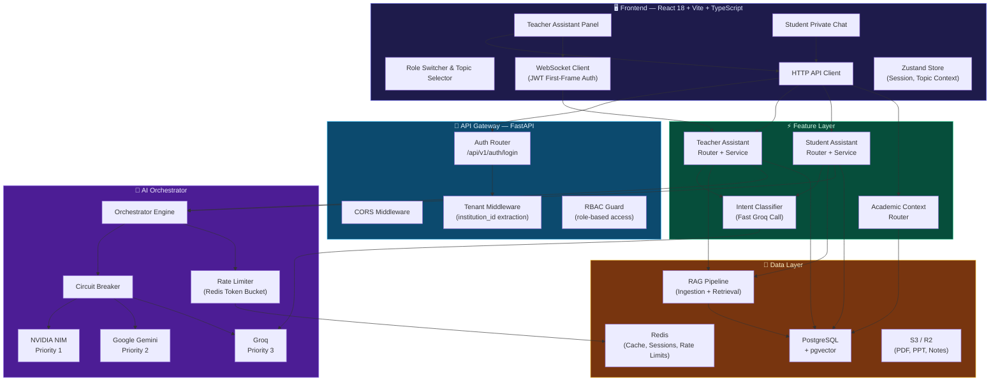
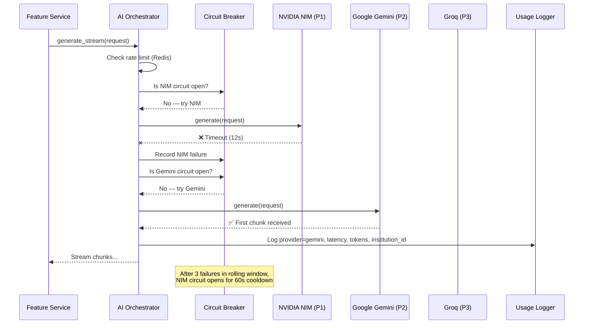
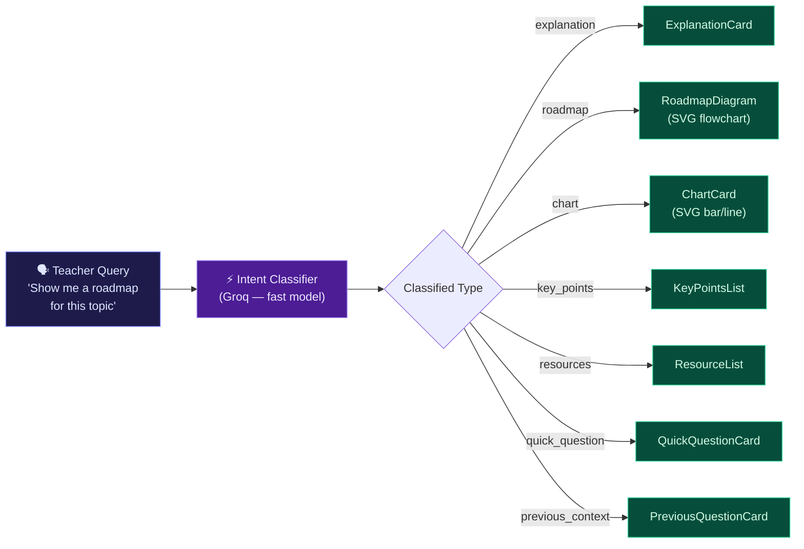
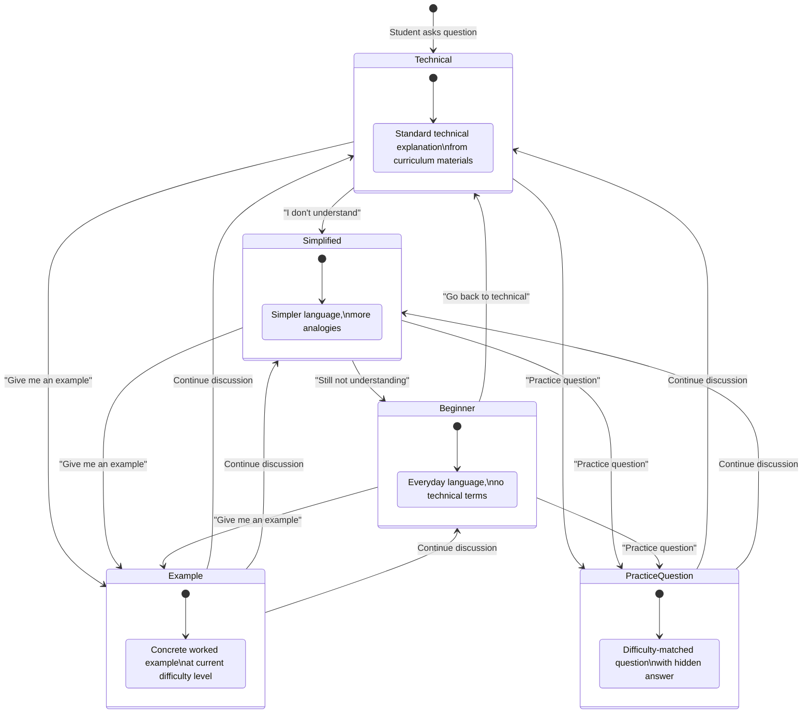
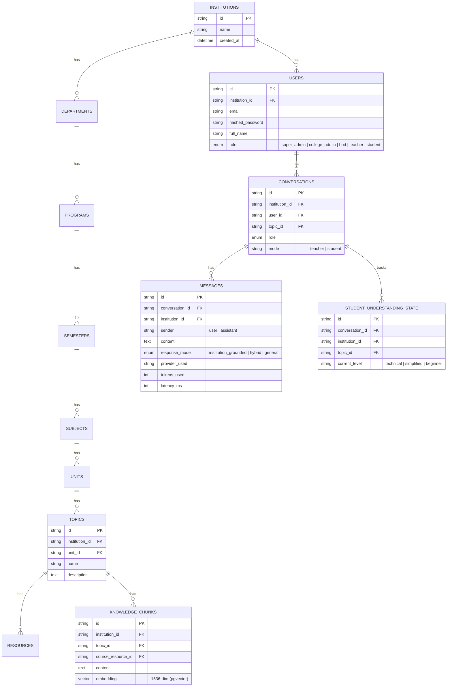
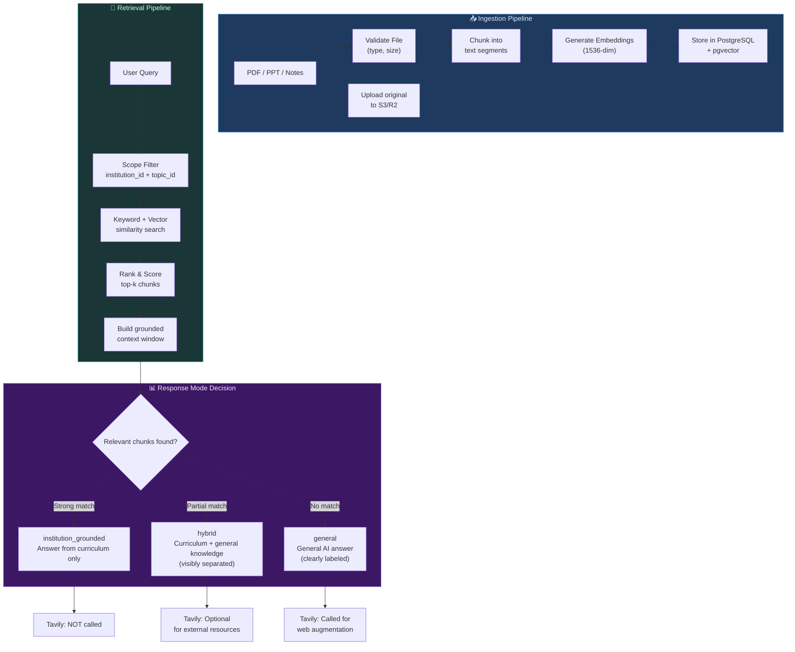
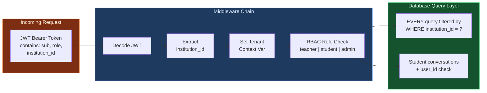
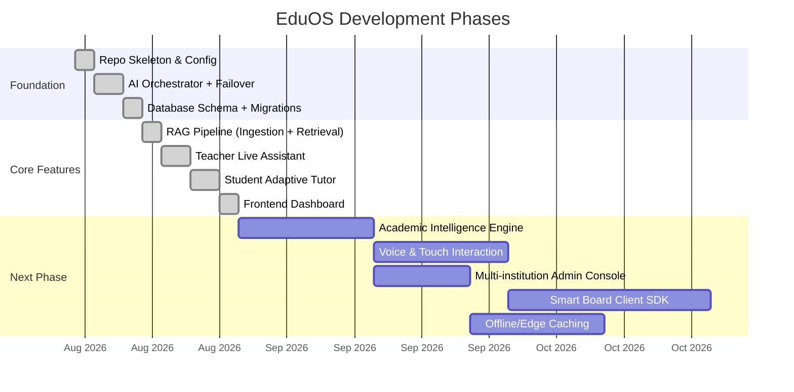

<p align="center">
  
  
  
</p>

<h1 align="center">🎓 EduOS — AI Education Operating System</h1>

<p align="center">
  <strong>An institution-aware, multi-tenant AI platform that transforms classroom teaching and private student learning through intelligent, grounded AI assistants.</strong>
</p>

<p align="center">
  <code>React 18</code> · <code>TypeScript</code> · <code>FastAPI</code> · <code>PostgreSQL + pgvector</code> · <code>NVIDIA NIM</code> · <code>Gemini</code> · <code>Groq</code>
</p>

---

## 📋 Table of Contents

- [Vision](#-vision)
- [System Architecture](#-system-architecture)
- [AI Orchestrator & Failover](#-ai-orchestrator--failover-chain)
- [Feature 1 — Teacher Live Assistant](#-feature-1--teacher-live-teaching-assistant)
- [Feature 2 — Student Adaptive Tutor](#-feature-2--student-private-adaptive-learning-assistant)
- [Data Model](#-data-model--academic-hierarchy)
- [RAG Pipeline](#-rag-pipeline)
- [Multi-Tenant Security](#-multi-tenant-security--isolation)
- [Tech Stack](#%EF%B8%8F-tech-stack)
- [Repository Structure](#-repository-structure)
- [Getting Started](#-getting-started)
- [API Reference](#-api-reference)
- [Smart Board Readiness](#-smart-board-readiness)
- [Testing](#-testing)
- [Roadmap](#-roadmap)

---

## 🌟 Vision

EduOS is **not** a chatbot bolted onto a textbook. It is a **software-layer operating system** for education that:

1. **Empowers teachers** with a real-time in-class copilot — generating explanations, roadmaps, charts, and quiz questions on demand, grounded in the institution's own curriculum materials.
2. **Protects students** with a private, judgment-free adaptive tutor that remembers where they got stuck and progressively simplifies until they understand.
3. **Isolates institutional data** — one college's notes, question papers, and student conversations are cryptographically separated from another's, even at the database query level.
4. **Stays provider-independent** — the AI brain can transparently switch between NVIDIA NIM, Google Gemini, and Groq without any feature code knowing or caring.

> **Core principle:** *Teacher-first, human-controlled.* Nothing the AI generates is auto-published. It is always presented for the teacher or student to review, use, or discard.

---

## 🏛️ System Architecture



---

## 🧠 AI Orchestrator & Failover Chain

The orchestrator is the **single most important module**. Every AI call flows through it — no feature code ever imports a provider SDK directly.



### Provider Priority & Failover Logic

| Priority | Provider | Role | Timeout |
|----------|----------|------|---------|
| 🥇 1st | **NVIDIA NIM** | Best reasoning quality for structured educational content | 12s |
| 🥈 2nd | **Google Gemini** | Strong multimodal + long-context fallback | 12s |
| 🥉 3rd | **Groq** | Fastest inference — also used for intent classification | 12s |

**Circuit Breaker:** 3 failures → 60s cooldown. Prevents hammering a dead provider on every request.

**Rate Limiter:** Redis token-bucket per `institution_id`, configurable requests/minute.

---

## 🍎 Feature 1 — Teacher Live Teaching Assistant

A side-panel copilot the teacher talks to **mid-class**. The teacher stays in control — nothing is auto-shown to students.

### Request → Classification → Structured Response Flow



### Response Types & Structured Payloads

| Teacher Says | Response Type | Structured JSON Shape |
|---|---|---|
| "Explain CNN with a simple real-world example" | `explanation` | `{summary, real_world_example, key_points[]}` |
| "Show me a simple roadmap for this topic" | `roadmap` | `{nodes: [{id, label, order}], edges: [{from, to}]}` |
| "Give me a chart for X" | `chart` | `{chart_type, labels[], series[]}` |
| "Key points for this unit" | `key_points` | `{points: string[]}` |
| "What resources do I have?" | `resources` | `{resources: [{title, type, url_or_ref}]}` |
| "Give me a quick question to ask the class" | `quick_question` | `{question, expected_answer_hint}` |

> **Smart Board Ready:** All responses are **structured JSON**, never pre-rendered HTML. A future board client renders the same payloads with its own UI.

---

## 🎓 Feature 2 — Student Private Adaptive Learning Assistant

The **hero feature**. A student never has to raise their hand. They ask privately, and the assistant **remembers where they got stuck** and progressively simplifies.

### Adaptive Level State Machine



### Key Behaviors

- **Level only moves down** (simplifies) on explicit student signals — *never* guesses frustration from sentiment.
- **State is server-side** (`student_understanding_state` table) — reloading the page preserves the current level.
- **Privacy is enforced at the query layer** — student conversations are visible **only** to that student, never surfaced to teachers or classmates.
- **`suggested_next_actions`** drives quick-reply buttons so the student never has to guess what to type next.

---

## 📊 Data Model & Academic Hierarchy



> **Every table carries `institution_id`. Every query filters by it.** This is non-negotiable — retrofitting tenant isolation later is expensive and dangerous.

---

## 🔍 RAG Pipeline



### Response Mode Guarantees

| Mode | Source | Tavily Used? | Label in Response |
|------|--------|-------------|-------------------|
| `institution_grounded` | Only institutional chunks | ❌ Never | `grounded_content` field |
| `hybrid` | Institutional + general knowledge | 🔶 Optional | Both `grounded_content` and `general_content` fields, **visibly separated** |
| `general` | General AI knowledge only | ✅ For web context | `general_content` field, clearly labeled |

---

## 🔒 Multi-Tenant Security & Isolation



**Key Guarantees:**
- 🔐 JWT bearer tokens (not cookies) — device/board compatible
- 🏢 `institution_id` embedded in every token, checked on every request
- 🚫 No cross-tenant data leakage, even at the DB query level
- 🙈 Student conversations are **never** visible to teachers or classmates (enforced server-side)
- 🔑 Secrets loaded from environment variables, never hardcoded, never logged, never returned in API responses

---

## ⚙️ Tech Stack

| Layer | Technology | Purpose |
|-------|-----------|---------|
| **Frontend** | React 18 + Vite + TypeScript | Fast dev loop, type-safe components |
| **Styling** | Tailwind CSS v4 | Utility-first, dark glassmorphism theme |
| **State** | Zustand (UI) + TanStack Query (server) | Clean separation of concerns |
| **Realtime** | Native WebSocket | Streamed AI responses with JWT auth handshake |
| **Backend** | Python 3.11 + FastAPI | Async, typed, OpenAPI docs auto-generated |
| **Validation** | Pydantic v2 | Request/response contracts |
| **Primary DB** | PostgreSQL + pgvector | Relational hierarchy + vector similarity |
| **Cache** | Redis | Rate limiting, session storage, response cache |
| **Object Store** | S3 / Cloudflare R2 | PDF, PPT, notes binary storage |
| **AI Provider 1** | NVIDIA NIM | Best reasoning for structured educational content |
| **AI Provider 2** | Google Gemini | Multimodal + long-context fallback |
| **AI Provider 3** | Groq | Fastest inference + intent classification |
| **Web Search** | Tavily API | External resource augmentation (general mode only) |
| **Auth** | JWT (access + refresh) | Stateless, board-compatible authentication |
| **Containers** | Docker + docker-compose | PostgreSQL + Redis local environment |

---

## 📁 Repository Structure

```
EduOS---AI-Education-Operating-System-/
│
├── Code/
│   ├── .agents/
│   │   └── skills/
│   │       └── eduos-prototype-builder/
│   │           └── SKILL.md                    # Agent operating instructions
│   │
│   └── DEV/
│       ├── .env.example                        # Environment variable template
│       ├── docker-compose.yml                  # Postgres + Redis containers
│       │
│       ├── backend/
│       │   ├── app/
│       │   │   ├── main.py                     # FastAPI app entry point
│       │   │   ├── core/
│       │   │   │   ├── config.py               # Pydantic settings (env loading)
│       │   │   │   ├── security.py             # JWT creation, verification, RBAC
│       │   │   │   └── tenant.py               # Multi-tenant context middleware
│       │   │   ├── ai/
│       │   │   │   ├── orchestrator.py         # Failover engine (NIM → Gemini → Groq)
│       │   │   │   └── providers/
│       │   │   │       ├── base.py             # AIProvider protocol + dataclasses
│       │   │   │       ├── nim_provider.py      # NVIDIA NIM wrapper
│       │   │   │       ├── gemini_provider.py   # Google Gemini wrapper
│       │   │   │       └── groq_provider.py     # Groq wrapper
│       │   │   ├── rag/
│       │   │   │   ├── ingestion.py            # Doc → chunks → embeddings
│       │   │   │   ├── retrieval.py            # Tenant-scoped similarity search
│       │   │   │   └── tavily_client.py        # External web search (isolated)
│       │   │   ├── features/
│       │   │   │   ├── auth/router.py          # Login endpoint
│       │   │   │   ├── academic/router.py      # Curriculum context endpoint
│       │   │   │   ├── teacher_assistant/
│       │   │   │   │   ├── router.py           # REST + WebSocket endpoints
│       │   │   │   │   ├── service.py          # Intent classification + generation
│       │   │   │   │   └── schemas.py          # Pydantic models (7 response types)
│       │   │   │   └── student_assistant/
│       │   │   │       ├── router.py           # REST endpoint
│       │   │   │       ├── service.py          # Adaptive state machine + generation
│       │   │   │       └── schemas.py          # Pydantic models
│       │   │   ├── db/
│       │   │   │   ├── models.py               # SQLAlchemy models (12 tables)
│       │   │   │   ├── session.py              # Async session factory
│       │   │   │   └── seed.py                 # Demo institution + CNN topic data
│       │   │   └── ws/
│       │   │       └── stream.py               # Shared WebSocket streaming handler
│       │   ├── tests/                          # 17 passing tests
│       │   └── requirements.txt
│       │
│       └── frontend/
│           ├── src/
│           │   ├── App.tsx                     # Main dashboard layout + role switcher
│           │   ├── main.tsx                    # React entry + QueryClientProvider
│           │   ├── index.css                   # Tailwind v4 theme + glassmorphism
│           │   ├── lib/
│           │   │   ├── api.ts                  # HTTP client (auth, assistant, academic)
│           │   │   └── ws.ts                   # WebSocket client (JWT auth handshake)
│           │   ├── store/
│           │   │   └── store.ts                # Zustand global state
│           │   └── features/
│           │       ├── teacher-assistant/
│           │       │   ├── TeacherAssistant.tsx # Side panel + quick chips
│           │       │   └── ResponseRenderers.tsx# 7 custom SVG/card renderers
│           │       └── student-assistant/
│           │           └── StudentAssistant.tsx # Private chat + adaptive UI
│           ├── tailwind.config.js
│           ├── postcss.config.js
│           └── vite.config.ts
│
└── Readme.md                                   # ← You are here
```

---

## 🚀 Getting Started

### Prerequisites

- **Node.js** ≥ 18 and **npm** ≥ 9
- **Python** ≥ 3.10
- (Optional) **Docker** for PostgreSQL + Redis containers

### 1. Clone the repository

```bash
git clone https://github.com/Mithun017/EduOS---AI-Education-Operating-System-.git
cd EduOS---AI-Education-Operating-System-
```

### 2. Set up the Backend

```bash
cd Code/DEV/backend

# Create virtual environment
python -m venv venv
source venv/bin/activate  # Windows: venv\Scripts\activate

# Install dependencies
pip install -r requirements.txt

# Configure environment (copy and edit)
cp ../.env.example .env
# Edit .env with your API keys (optional — mock mode works without keys)

# Seed the demo database
python -m app.db.seed

# Start the server
python -m uvicorn app.main:app --reload --port 8000
```

### 3. Set up the Frontend

```bash
cd Code/DEV/frontend

# Install dependencies
npm install

# Start development server
npm run dev
```

### 4. Open the App

Navigate to **http://localhost:5173** in your browser. The dashboard auto-logs in as a Teacher and loads the demo CNN topic.

> **No API keys?** The frontend includes a **Demo Simulation** toggle that provides high-fidelity mock responses for all features — roadmaps, explanations, adaptive tutoring — so you can demo the full flow offline.

---

## 📡 API Reference

### Authentication

```
POST /api/v1/auth/login
Body: { "email": "teacher@demo.eduos.ai", "password": "password123" }
→ { "access_token": "...", "role": "teacher", "full_name": "Prof. Sarah Jenkins", "institution_id": "demo-inst-001" }
```

### Teacher Assistant

```
POST /api/v1/teacher-assistant/ask
Headers: Authorization: Bearer <token>
Body: { "topic_id": "uuid", "message": "Explain CNN simply", "response_mode_hint": "hybrid" }
→ { "response_type": "explanation", "structured_data": {...}, "response_mode": "hybrid", "provider_used": "nvidia_nim" }

WebSocket: /api/v1/teacher-assistant/ws/{conversation_id}
First frame: { "type": "auth", "token": "<jwt>" }
Subsequent: { "topic_id": "uuid", "message": "..." }
```

### Student Assistant

```
POST /api/v1/student-assistant/ask
Headers: Authorization: Bearer <token>
Body: { "topic_id": "uuid", "conversation_id": null, "message": "I don't understand CNN" }
→ { "current_level": "simplified", "content": "...", "suggested_next_actions": ["Give me an example", "Explain simpler"] }
```

### Academic Context

```
GET /api/v1/academic/context
→ [{ "id": "...", "name": "Deep Learning", "code": "CS601DL", "units": [{ "topics": [...] }] }]
```

---

## 📺 Smart Board Readiness

The backend is **designed from day one** to support a future smart board hardware client without any rewrite:

| Requirement | Status |
|-------------|--------|
| All responses are structured JSON, not pre-rendered HTML | ✅ |
| Auth is JWT bearer-token based, not cookie-session based | ✅ |
| WebSocket transport is UI-agnostic | ✅ |
| Roadmaps returned as `{nodes[], edges[]}`, not SVG strings | ✅ |
| Charts returned as `{chart_type, labels[], series[]}` data | ✅ |

> A board client is **just another frontend** that renders the same API payloads with its own touch-optimized UI.

---

## 🧪 Testing

```bash
cd Code/DEV/backend
pytest
```

**17 tests** covering:

| Test Suite | Tests | What It Verifies |
|------------|-------|------------------|
| `test_orchestrator.py` | 5 | Provider failover chain, circuit breaker, rate limiting |
| `test_rag_pipeline.py` | 4 | File validation, tenant-scoped retrieval, S3 key formatting |
| `test_student_adaptive.py` | 2 | Level state transitions, adaptive response generation |
| `test_tenant_isolation.py` | 3 | Cross-institution data isolation at the DB query level |
| `test_ws_auth.py` | 3 | WebSocket JWT handshake, unauthenticated rejection |

---

## 🗺️ Roadmap



### What's Built (Prototype v1.0)
- ✅ AI Orchestrator with NIM → Gemini → Groq failover
- ✅ Teacher Live Teaching Assistant (7 response types)
- ✅ Student Private Adaptive Learning Assistant (state machine)
- ✅ Tenant-isolated RAG pipeline
- ✅ Premium React dashboard with role switching

### What's Next
- 🔲 Academic Intelligence Engine (question-paper frequency, Bloom's analysis)
- 🔲 Voice, touch, and stylus interaction
- 🔲 Offline/edge caching for low-connectivity classrooms
- 🔲 Multi-institution admin console
- 🔲 Smart board hardware client SDK

---

## 👥 Demo Users (Seeded)

| Email | Password | Role | Name |
|-------|----------|------|------|
| `teacher@demo.eduos.ai` | `password123` | Teacher | Prof. Sarah Jenkins |
| `student@demo.eduos.ai` | `password123` | Student | Alex Chen |
| `admin@demo.eduos.ai` | `password123` | Super Admin | Dr. Aris Thorne |

**Demo Institution:** EduOS Demo College (`demo-inst-001`)
**Demo Topic:** Convolutional Neural Networks (CNN) — Deep Learning & Neural Networks, Semester 6

---

<p align="center">
  <sub>Built with 🧠 by <strong>Mithun</strong> — EduOS © 2026</sub>
</p>
